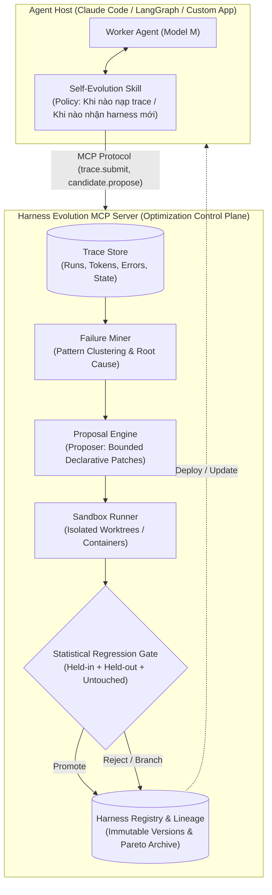
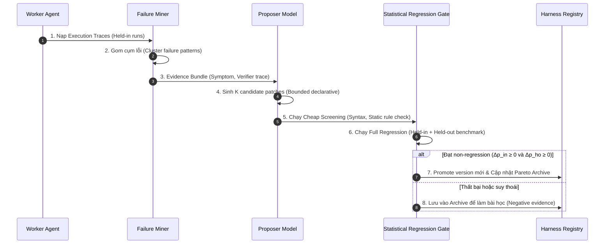

# Bộ Khung Harness Tối Ưu Cho Từng Agent (Model-Specific & Role-Specific Agent Harness Framework)

> **Căn cứ nghiên cứu**: Tổng hợp & mở rộng từ công trình nghiên cứu *“Từ Self-Harness và Harness Evolution đến một nền tảng tối ưu hóa agent dưới dạng Skill + MCP Server”* (tổng hợp thực nghiệm từ Self-Harness, The Last Harness, Meta-Harness, ADAS, Darwin Gödel Machine, Evo-Harness, SkillOS, ACE và ReHarness).

---

## 1. Bản chất & Nguyên lý Cốt lõi (Foundational Principles)

### 1.1. Định luật Tối ưu hóa Harness: $Agent = Model + Harness$
Năng lực giải quyết bài toán của AI Agent không chỉ phụ thuộc vào trọng số mô hình ($Model$), mà phần lớn được quyết định bởi **Harness** — lớp vỏ bao quanh mô hình gồm:
- System prompt & Identity
- Action space & Tool contract
- Skill Repository (SkillRepo) & Runtime Playbook
- Runtime control policy (loop breaking, step budget, timeout)
- Memory & Context management policy
- Verification & Evaluator protocol
- Error recovery & Self-healing mechanics

### 1.2. Nguyên lý Phân hóa theo Mô hình (Model-Specific Specialization)
Thực nghiệm trên Terminal-Bench-2.0 chứng minh: **Không tồn tại "Universal System Prompt" hay một Harness chung tối ưu cho mọi LLM**:
- **MiniMax M2.5**: Tăng từ 40.5% lên 61.9% nhờ ép tạo artifact sớm (*early artifact creation*) và chặn lặp vòng tool (*tool loop bounding*).
- **Qwen3.5-35B-A3B**: Tăng từ 23.8% lên 38.1% nhờ kiểm tra dependency (*dependency checking*), ngắt lặp (*loop breaking*), kỷ luật retry (*retry discipline*) và phục hồi artifact.
- **GLM-5**: Tăng từ 42.9% lên 57.1% nhờ tính bền vững của môi trường (*environment persistence*) và chuyển dịch sớm từ giai đoạn thám sát (*exploration*) sang triển khai (*implementation*).

### 1.3. Nguyên lý Tách rời Năng lực: *Updater $\neq$ Beneficiary*
Khả năng đề xuất cải tiến harness (*Evolver / Proposer*) không đồng nhất với năng lực hưởng lợi từ harness đó (*Worker / Executor*):
- Model nhỏ/yếu thường không thể tự tìm ra lỗi hệ thống của chính mình và không tự điều chỉnh prompt phức tạp được, nhưng lại hưởng lợi cực lớn nếu được cấp một Harness có guardrail chặt chẽ.
- Model siêu mạnh (Frontier/Reasoning) có thể làm Proposer/Adjudicator xuất sắc, nhưng nếu ép vào một Harness quá gò bó thì lại bị giảm tính sáng tạo và lãng phí token suy luận.
- **Quy tắc**: Phân tách 3 vai trò rõ rệt:
  1. **Worker (Executor)**: Model thực thi task dưới Harness được cấu hình tối ưu cho riêng nó.
  2. **Proposer / Evolver**: Model chuyên trách phân tích trace failure và sinh patch có cấu trúc.
  3. **Adjudicator / Evaluator**: Bộ thẩm định bất biến (Immutable Evaluator) để tránh hiện tượng *Optimizer gaming Evaluator* (Luật Goodhart).

---

## 2. Kiến trúc Hệ thống: Hybrid 3 Tầng (3-Tier Optimization Architecture)

Hệ thống kết hợp ba thành phần chặt chẽ:
1. **Control Plane (Harness Evolution MCP Server)**: Quản lý trace store, cluster lỗi, sinh candidate, chạy sandbox, kiểm định non-regression gate, quản lý lineage và rollback.
2. **Agent-facing Policy (Portable Skill)**: Gói skill gọn nhẹ hướng dẫn Agent cách ghi nhận trace (`trace.submit`), nhận diện tiêu chí thành công và nạp harness mới được promote mà không làm phình context.
3. **Execution Shell (Host Integrations)**: Tích hợp với Claude Code, OpenAI Agents SDK, LangGraph, v.v.



---

## 3. Cấu trúc Chuẩn: Bề mặt Có kiểu (`HarnessManifest`)

Thay vì để optimizer chỉnh sửa mã nguồn tùy tiện (unbounded arbitrary code edits), Harness được định nghĩa qua một Manifest chứa **6 bề mặt có kiểu (Typed Editable Surfaces)** và **vùng bất biến (Immutable Boundaries)**:

```json
{
  "$schema": "https://json-schema.org/draft/2020-12/schema",
  "harness_id": "swe-agent-v14",
  "version": "1.4.0",
  "model_profile": {
    "provider": "anthropic",
    "model_name": "claude-3-7-sonnet",
    "context_window": 200000,
    "reasoning_mode": true
  },
  "surfaces": {
    "system_prompt": {
      "path": "prompts/system.md",
      "max_tokens": 1500,
      "immutable_sections": ["core_identity", "safety_rules"]
    },
    "skills": {
      "repo_dir": "skills/",
      "active_skills": ["git-ops", "test-driven-dev", "error-recovery"],
      "retrieval_mode": "explicit_routed",
      "max_active_skills": 4
    },
    "tool_policy": {
      "path": "config/tools.yaml",
      "granularity": "medium",
      "strict_schema_enforcement": true,
      "format_contract": {
        "require_status": true,
        "require_summary": true,
        "require_next_actions": true,
        "require_artifacts": true
      }
    },
    "runtime_policy": {
      "path": "config/runtime.yaml",
      "max_steps": 25,
      "max_consecutive_same_tool_errors": 2,
      "loop_detection_window": 3,
      "timeout_per_step_sec": 30,
      "cost_budget_usd": 0.50
    },
    "memory_policy": {
      "path": "config/memory.yaml",
      "compaction_trigger": "phase_boundary",
      "scratchpad_format": "xml_structured",
      "max_context_budget_tokens": 12000
    },
    "verification_policy": {
      "path": "config/verification.yaml",
      "verifier_type": "deterministic_with_fallback",
      "non_regression_margin": 0.0,
      "confidence_level": 0.95
    }
  },
  "immutable_boundaries": [
    "secrets/**",
    "auth/**",
    "billing/**",
    "sandbox/**",
    "infrastructure/**"
  ]
}
```

---

## 4. Bảng Phân Hóa Harness Tối Ưu Cho Từng Dòng Model & Role

Dưới đây là ma trận cấu hình Harness được tinh chỉnh dựa trên điểm yếu cố hữu (failure patterns) của từng nhóm model:

| Nhóm Model | Điểm yếu thường gặp (Traces) | Bề mặt Harness cần ưu tiên tối ưu | Thiết lập khuyến nghị (Recommended Policy) |
| :--- | :--- | :--- | :--- |
| **Nhỏ / Biên / Tốc độ cao**<br>*(Qwen-35B, MiniMax, Gemini Flash, Haiku)* | - Lặp vòng tool call khi gặp lỗi syntax.<br>- Không tuân thủ hướng dẫn quá dài.<br>- Ngốn token khi đọc log lớn. | **Runtime Policy** & **Tool Policy** | - `max_consecutive_same_tool_errors: 2`<br>- Tool output phải trả về `root_cause_hint` + `safe_retry_instruction`.<br>- Thu nhỏ system prompt (< 1000 tokens), nạp skill dạng on-demand.<br>- Ép tạo artifact sớm để giữ trạng thái. |
| **Lập luận Chuyên sâu / Frontier**<br>*(Claude 3.7 Sonnet, GPT-4o, GLM-5)* | - Over-exploration (thám sát quá nhiều bước trước khi sửa code).<br>- Tự phản biện lan man, tốn token suy luận không cần thiết. | **Runtime Policy** & **Memory Policy** | - Chặn pha thám sát: chuyển từ `exploration` $\to$ `implementation` sau tối đa 4 bước đọc file.<br>- Macro-tools: gộp các bước đọc/ghi liên quan để giảm round-trip.<br>- Compaction ở biên của từng phase thay vì dựa trên token threshold. |
| **Mô hình Mã nguồn mở Local**<br>*(Llama 3 8B/70B, DeepSeek R1/Coder)* | - Dễ hallucinate đối số tool schema.<br>- Trôi ngữ cảnh qua các turn dài.<br>- Format đầu ra thiếu ổn định. | **Tool Policy** & **Verification Policy** | - Strict JSON Schema validation trước khi đẩy vào runtime.<br>- Deterministic Verifier: luôn chạy compiler / linter kiểm tra cú pháp sau mỗi edit.<br>- Thêm cơ chế rollback trạng thái file tự động nếu test fail 2 lần. |

---

## 5. Bốn Pha Tìm Kiếm & Kiểm Định Cải Tiến Harness

Để tránh việc harness bị quá khớp (overfitting) hoặc suy giảm hiệu năng ngoài ý muốn (regression), quy trình tiến hóa tuân thủ chu trình 4 pha nghiêm ngặt:



### 5.1. Hàm Mục tiêu Đa Chiều (Multi-Objective Evaluation)
Vector đánh giá của candidate $c$:
$$m(c) = [p_{\text{pass}}, C, L, T, R]$$
Trong đó:
- $p_{\text{pass}}$: Tỷ lệ giải quyết thành công bài toán (Pass rate).
- $C$: Chi phí tiêu thụ token / API cost (USD).
- $L$: Độ trễ trung bình hoàn thành task (Latency).
- $T$: Số lượng lệnh gọi tool (Tool calls count).
- $R$: Tỷ lệ vi phạm an toàn / rủi ro runtime (Safety/Risk rate).

Điều kiện nghiệm khả thi (**Feasible Condition**):
$$\text{Feasible}(c) = \begin{cases} 
1 & \text{khi } \Delta p_{\text{heldout}} \ge -\epsilon_p \land \Delta R \le \epsilon_R \land C \le C_{\max} \land L \le L_{\max} \\ 
0 & \text{ngược lại} 
\end{cases}$$

Hàm xếp hạng thỏa dụng (**Utility Ranking**):
$$U(c) = w_p \Delta p - w_C \Delta C - w_L \Delta L - w_T \Delta T$$

### 5.2. Phân Tách 3 Tập Dữ Liệu Kiểm Thử (3-Split Benchmark Separation)
1. **Optimization Set (Held-in)**: Tập hợp task dùng để khai phá lỗi và sinh proposal.
2. **Promotion Set (Held-out)**: Tập hợp task độc lập dùng để tính toán non-regression gate trước khi promote.
3. **Untouched Audit Set**: Tập bài kiểm tra được niêm phong, không bao giờ cung cấp trace hay metric cho optimizer, chỉ kích hoạt định kỳ (weekly/monthly) để rà soát hiện tượng "overfitting to held-out".

---

## 6. Danh Mục MCP Primitives Chuẩn Hóa

### 6.1. Tools
- `trace.submit`: Nạp execution trace, logs, tool outputs, verifier results từ runtime.
- `failures.mine`: Phân tích cụm lỗi từ trace store, phân loại lỗi cú pháp, logic, lặp vòng hay cạn budget.
- `candidate.propose`: Sinh $K$ đề xuất chỉnh sửa harness có giới hạn (bounded patches).
- `candidate.materialize`: Tạo isolated worktree/branch chứa bản vá cấu hình.
- `benchmark.run`: Chạy bộ testsuite trên candidate trong môi trường sandbox cô lập.
- `candidate.compare`: So sánh thống kê (paired bootstrap test) giữa candidate và baseline.
- `candidate.promote`: Nâng cấp candidate thành phiên bản chính thức (Production).
- `candidate.rollback`: Thu hồi tức thì về phiên bản ổn định trước đó.

### 6.2. Resources
- `harness://{id}/{version}`: Trả về toàn bộ file manifest, prompt và config của harness.
- `trace://{run_id}`: Nhật ký chi tiết của một lần thực thi.
- `eval://{experiment_id}`: Bảng ma trận kết quả kiểm thử.
- `failure://{cluster_id}`: Bằng chứng gom cụm lỗi (Evidence bundle).
- `lineage://{harness_id}`: Cây phả hệ tiến hóa và các nhánh chuyên biệt (Pareto front).

---

## 7. Khuyến Nghị Lộ Trình Triển Khai (Roadmap)

1. **Giai đoạn 1 - PoC (Harness Tĩnh & Bounded Edits)**:
   - Xây dựng file `HarnessManifest` chuẩn hóa.
   - Giới hạn chỉnh sửa chỉ trên `runtime_policy.yaml` và `system_prompt.md`.
   - Dùng 20–30 testcase có deterministic verifier để chứng minh tỷ lệ pass tăng mà không suy thoái.
2. **Giai đoạn 2 - MVP (MCP Server + SkillRepo)**:
   - Đóng gói Harness Evolution MCP Server.
   - Thêm `skills/` với cơ chế explicit routing (SkillOS/Evo-Harness style).
   - Thiết lập held-in và held-out regression gate.
3. **Giai đoạn 3 - Production (Pareto Archive & Canary Rollout)**:
   - Duy trì các nhánh chuyên hóa: `coding-specialist`, `speed-specialist`, `low-cost-specialist`.
   - Cơ chế Canary Traffic (1% $\to$ 5% $\to$ 100%) kèm Auto-Rollback khi vi phạm SLO.
